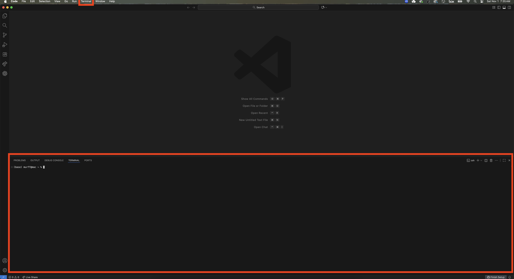
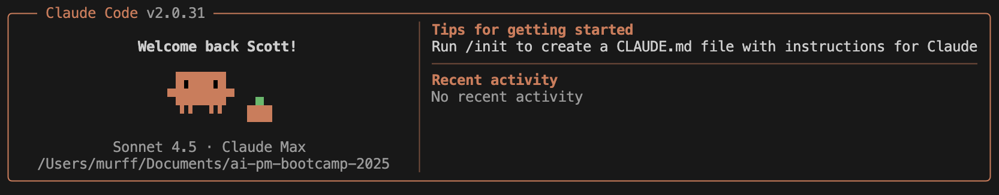
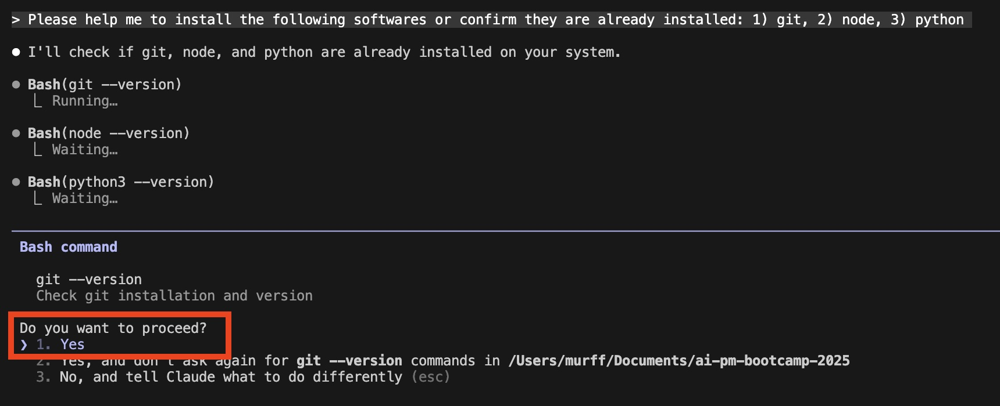
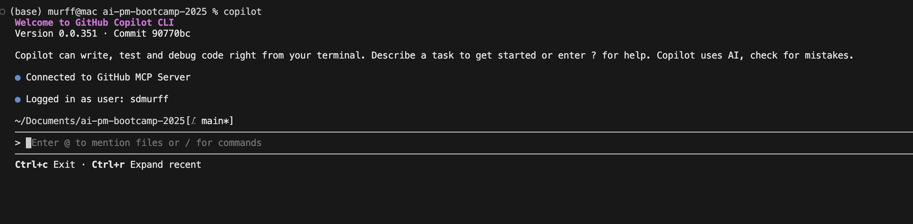
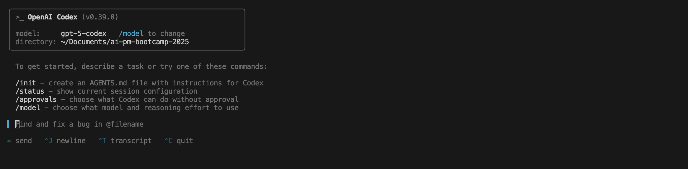

*Complete setup during Week 1 (February 22–28). You may start early. Setup is an ungraded Week 1 activity; use the first class to write the Sprint 1 plan. Setup actions take additional time beyond the weekly reading estimate.*

**Laptop requirement:** You need your own Windows or macOS laptop with at least 4GB of RAM (more is better). Bring a charging cord, and a mouse if you like using one.

**If at any point you get stuck or something does not work as expected,** take a screenshot or copy the text you see into ChatGPT, Claude, or Gemini and ask for help troubleshooting. If it is still not working, ask in the course communication channel (________) or email a TA.

## 1. Choose your coding agent

**Codex is the primary option. Claude is a supported alternative.** Choose one for setup, sprint plans, reviews, and learning activities. You do not need both paid subscriptions.

- [ ] For Codex, check [OpenAI's current access and pricing information](https://learn.chatgpt.com/docs/pricing) and use a ChatGPT account with Codex access.
- [ ] For Claude, check [Anthropic's current access requirements](https://code.claude.com/docs/en/quickstart) and use an account with Claude Code access.

Account or funding arrangements for this offering: ________. Do not assume grants or discounts from another university apply.

## 2. Create a free GitHub account

- [ ] Go to [github.com](https://github.com/)
- [ ] Create a **free account**

## 3. Create a free Supabase account

- [ ] Go to [supabase.com](https://supabase.com/)
- [ ] Sign up for a **free account**
- [ ] You can sign up using your GitHub account for easier integration

## 4. Create a free Vercel account

- [ ] Go to [vercel.com](https://vercel.com/)
- [ ] Sign up for a **free account**
- [ ] You can sign up using your GitHub account for easier deployment

## 5. Install Visual Studio Code (VS Code)

- [ ] Download from [code.visualstudio.com](https://code.visualstudio.com/)
- [ ] During installation, if prompted:
  - [ ] Check **"Add to PATH"**
  - [ ] Enable **"Open with Code"** context-menu option (Windows users)

## 6. Start your coding agent within VS Code

### Codex: primary option {#codex-setup}

Open VS Code and choose **Terminal > New Terminal**. Install the Codex CLI using the command for your operating system from [OpenAI's installation guide](https://learn.chatgpt.com/docs/codex/cli).

**macOS**

```bash
curl -fsSL https://chatgpt.com/codex/install.sh | sh
```

**Windows PowerShell**

```powershell
powershell -ExecutionPolicy ByPass -c "irm https://chatgpt.com/codex/install.ps1 | iex"
```

Then check installation and start the agent:

```bash
codex --version
codex
```

Choose **Sign in with ChatGPT** when prompted and finish sign-in in your browser. Use the official installation guide if your computer needs additional setup. The [Codex appendix](A4-codex-cli-and-desktop.qmd) also describes the desktop option.

Once signed in, ask:

> Check whether git, GitHub CLI (gh), Node.js, and Python are installed. Explain anything missing and help me install it for my operating system. Show commands before running them and wait for me to complete sign-in myself. Never ask me for a password or token.

Continue with [Recommended VS Code extensions](#recommended-vs-code-extensions), then the local [course starter and workflows](00-course-workflows.qmd). The following Claude walkthrough is only needed if you choose Claude instead.

### Claude Code: supported alternative {#claude-setup}

- [ ] Open the newly installed **VS Code** application
- [ ] In the top menu bar, click **Terminal → New Terminal**
  - This opens the **integrated terminal** at the bottom of VS Code
  - The terminal is where you will run commands.
    You should see something like:
    ```
    PS C:\Users\YourName>   ← Windows
    or
    yourname@MacBook-Pro ~ %   ← macOS
    ```

The terminal should appear as a new window pane within VS Code:



### Install Claude Code from the terminal

If you choose Claude, install the **Claude Code CLI (command-line interface)**. This tool connects VS Code directly to Claude.

Run **one** of the following commands inside the VS Code terminal, depending on your operating system.

::: {.callout-tip}
**Troubleshooting tip:** If at any point you get stuck or something is not working as expected, take a screenshot or copy the error message and surrounding context into ChatGPT, Claude, or Gemini and ask for help troubleshooting. Follow the troubleshooting instructions and within one or two rounds you should be able to continue. When errors arise, it is often because dependencies are not installed, so additional software needs to be installed first. AI chatbots will guide you through how to install these dependencies if needed.
:::

- [ ] Copy and paste this command into the terminal, then press **Enter**:

**On Windows**

```bash
irm https://claude.ai/install.ps1 | iex
```

**On macOS**

```bash
curl -fsSL https://claude.ai/install.sh | bash
```

- [ ] Once installation finishes, check that it worked by typing this into the terminal and pressing **Enter**:

```bash
claude --version
```

- [ ] Confirm you see output similar to:

```bash
2.0.31 (Claude Code)
```

- [ ] Start Claude Code by running the following command in the terminal:

```bash
claude
```

You will be prompted to authenticate your Claude account and will be routed to a web browser tab where you sign in. Once complete, return to VS Code and you should see something like:



Claude Code is now installed. We will use it to install the rest of the software you need to build full-stack applications, and to use AI on many other knowledge work tasks.

Paste the following prompt into the terminal where Claude Code is active:

> Please help me to install the following softwares or confirm they are already installed: 1) git, 2) node, 3) python

Review each proposed command before approving it. Claude Code works much like a normal chat bot and will make the remaining installations with your approval.



> **Note on using the terminal**
>
> The terminal is not quite like a normal text editor. You **cannot click anywhere in a line to move your cursor or edit text**.
> Instead, use the **arrow keys** on your keyboard to move left and right within the command you are typing.
> If you make a mistake, you can use:
>
> - **Backspace** (Windows) or **Delete** (Mac) to erase characters
> - **↑ (up arrow)** to recall your last command
> - **↓ (down arrow)** to move forward through your command history

### Recommended VS Code extensions {#recommended-vs-code-extensions}

Open the Extensions view (**Cmd+Shift+X** on macOS, **Ctrl+Shift+X** on Windows), search for each name, and click **Install**. All are free.

| Extension | What it does | Why it helps when you build with an agent |
|---|---|---|
| **ESLint** | Flags problems in JavaScript and TypeScript in projects set up with ESLint | Its warnings appear in VS Code's Problems panel |
| **Prettier - Code formatter** | Formats code the same way every time you save, once you set it as your default formatter | Your edits and the agent's follow one style |
| **Tailwind CSS IntelliSense** | Autocomplete and checks for Tailwind class names | Flags class names that do not exist |
| **GitLens** | Shows who changed each line, and when | Helps you review what the agent changed |
| **Python** (by Microsoft) | Python language support, including Pylance | Only if you write Python; its errors also appear in the Problems panel |

**For the Claude alternative:** You do not need to install the Claude Code extension yourself. The first time you run `claude` in VS Code's terminal, it installs the extension, which lets Claude open its changes in VS Code's diff viewer and see the text you have selected. [Claude Code in the VS Code terminal](A3-claude-code-cli-and-desktop.qmd#claude-code-in-the-vs-code-terminal) explains what that connection does.

::: {.callout-important}
**Next:** set up your builder repo and plan Sprint 1 with the setup prompt in [Sprint 1](00-assessments.qmd#sprint-1).
:::

## 7. Optional: other AI coding agents

You are now ready for the first class. Codex is the primary course option and Claude is the supported alternative. Other agents below are supplemental references; you do not need to install them. If you have accounts with other AI providers, install their agents too.

You may run the following commands from a new terminal window, or from within an active Claude Code session, in which case Claude will ask for permission and then run them for you.

**GitHub Copilot CLI** ([install options](https://docs.github.com/en/copilot/how-tos/copilot-cli/set-up-copilot-cli/install-copilot-cli)). Every GitHub Copilot plan includes it, including Copilot Free and Copilot Student, which is free for verified students through [GitHub Education](https://docs.github.com/en/copilot/how-tos/copilot-on-github/set-up-copilot/enable-copilot/set-up-for-students). It reads your `CLAUDE.md` and your Claude Code skills, so it is the closest free substitute if you ever lose access to Claude.

```bash
# macOS
brew install --cask copilot-cli
```

```powershell
# Windows
winget install GitHub.Copilot
```

**Codex installation reference** (already covered in the primary path above; [official install options](https://learn.chatgpt.com/docs/codex/cli))

```bash
# macOS
curl -fsSL https://chatgpt.com/codex/install.sh | sh
```

```powershell
# Windows (PowerShell)
powershell -ExecutionPolicy ByPass -c "irm https://chatgpt.com/codex/install.ps1 | iex"
```

**Antigravity CLI from Google** ([install options](https://antigravity.google/docs/getting-started)). It replaced Gemini CLI for personal Google accounts on June 18, 2026, and includes a free weekly quota.

```bash
# macOS
curl -fsSL https://antigravity.google/cli/install.sh | bash
```

```powershell
# Windows (PowerShell)
irm https://antigravity.google/cli/install.ps1 | iex
```

After installation, start each agent from a terminal in your project folder, the same way you started Claude Code: `copilot`, `codex`, or `agy`. The first time, each one asks you to sign in. [Claude Code and Other Coding Agents](A2-coding-agents-compared.qmd) maps the commands you learn in this course to each of them.

```bash
copilot
```



```bash
codex
```


