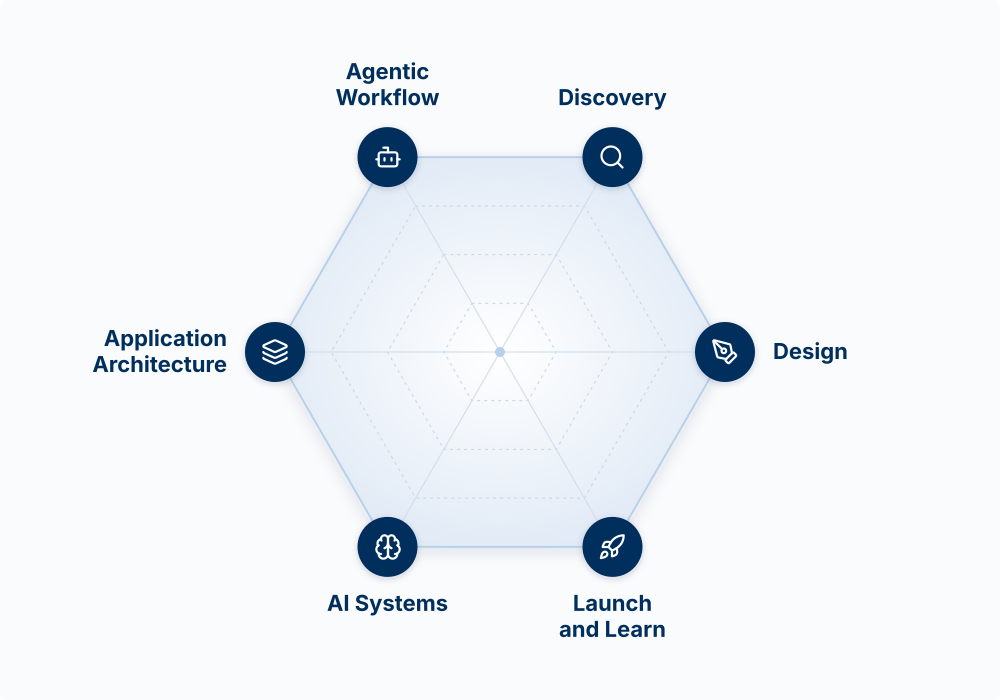

**BYU-Idaho Product Management | Winter 2027 Second Block**

The seven-week course runs **February 22 through April 8, 2027**. Week 7 ends on **Thursday, April 8**. The calendar establishes the weekly ranges below. Exact assignment deadlines, exam windows, and meeting details remain blank.

**Class format:** Short periods of focused instruction, live building with Codex (primary) or Claude (alternative), and review of student work. Meeting days and times: ________. Location or delivery format: ________.

## The six axes

The course retains six builder skills. Weeks 1–6 each emphasize one axis; Week 7 brings them together for testing, revision, and final demos. Rate yourself on all six in Week 1. Sprint reports show a [builder profile](00-assessments.qmd#builder-profile) on the same axes.

{fig-alt="A hexagon with the six builder axes: Agentic Workflow, Discovery, Design, Launch and Learn, AI Systems, and Application Architecture." fig-align="center" width="70%"}

| Axis | The question it answers | Week |
|---|---|---|
| Agentic Workflow | How do I put AI to work, as the way I build and inside the product? | 1 |
| Discovery | What should I build, for whom, and should I? | 2 |
| Design | What does the surface look like, how does it flow, and how do I write it down so an agent can build it? | 3 |
| Application Architecture | How is it structured, shipped, and kept safe? | 4 |
| AI Systems | How do the models work, and why do they behave the way they do? | 5 |
| Launch and Learn | How do people find it, and did it work? | 6 |

Agentic Workflow comes first on purpose. You will ship something in Week 1 that you do not fully understand, then learn how it works throughout the course.

## Weekly schedule

Required setup is part of Week 1. You may start the [setup checklist](00-computer-setup.qmd) early; there is no required extra setup week. Read the assigned chapters before the corresponding class. All original readings remain assigned.

| Week | Dates (2027) | Focus and readings | Assessment placement |
|---|---|---|---|
| 1 | Feb 22–28 | **Setup and Agentic Workflow:** [Computer Setup](00-computer-setup.qmd); [Building with AI Agents](01-building-with-ai-agents.qmd); [Directing the Agent](02-directing-the-agent.qmd) | Opening self-assessment; [Sprint 1](00-assessments.qmd#sprint-1) |
| 2 | Mar 1–7 | **Discovery:** [What Is Worth Building](03-what-is-worth-building.qmd); [Finding and Validating the Problem](04-finding-and-validating-the-problem.qmd) | [Sprint 2](00-assessments.qmd#sprint-2) |
| 3 | Mar 8–14 | **Design:** [Interface and Flow](05-interface-and-flow.qmd); [Design Fundamentals](05b-design-fundamentals.qmd); [Testing the Design](06-testing-the-design.qmd); [Specs: Designing the Build](06b-specs.qmd) | [Sprint 3](00-assessments.qmd#sprint-3); [midterm](00-assessments.qmd#midterm-exam) |
| 4 | Mar 15–21 | **Application Architecture:** [Anatomy of an Application](07-anatomy-of-an-application.qmd); [Data and APIs](08-data-and-apis.qmd); [Version Control, Environments, and Deploys](09-version-control-testing-and-tech-debt.qmd); [Tests and Tech Debt](09b-tests-and-tech-debt.qmd); [The Browser, Developer Tools, and Claude in Chrome](09c-browser-and-developer-tools.qmd) | [Sprint 4](00-assessments.qmd#sprint-4) |
| 5 | Mar 22–28 | **AI Systems:** [How Models Work](10-how-models-work.qmd); [Models in Your Product](11-models-in-your-product.qmd) | [Sprint 5](00-assessments.qmd#sprint-5) |
| 6 | Mar 29–Apr 4 | **Launch and Learn:** [Going to Market](12-going-to-market.qmd); [Business Models](13-business-models.qmd); [Measuring What Matters](14-measuring-what-matters.qmd) | [Sprint 6 begins](00-assessments.qmd#sprint-6); [peer testing assigned](00-assessments.qmd#peer-product-testing) |
| 7 | Apr 5–8 | **Final Demo and Wrap-up:** [Storytelling and the Final Demo](15-storytelling-and-the-final-demo.qmd) | [Sprint 6 completes](00-assessments.qmd#sprint-6); [peer testing](00-assessments.qmd#peer-product-testing); [final exam](00-assessments.qmd#final-exam); closing self-assessment |

## Demos and peer feedback

Every few weeks a portion of class is given over to small-group demos: you show your real, deployed product to three or four classmates, they tell you what worked and what confused them, and you spend the rest of the session building on what you heard.

These are informal working sessions. Bring something that runs. The first half of the course is mostly solo work, and these are your regular chance to see what classmates are building and to have people who have not seen your product try it before the final.

## Sprints

Sprints 1–5 each last one week. Sprint 6 spans Weeks 6–7. Every sprint follows the same sequence: plan, build, review, and demo. A sprint is a timebox; your work may advance any of the six axes. Full deliverables and rubrics are in [Assessments](00-assessments.qmd#sprints).

| Sprint | Placement | Plan deadline | Wrap-up deadline | Points |
|---|---|---|---|--:|
| [1](00-assessments.qmd#sprint-1) | Week 1 | ________ | ________ | 50 |
| [2](00-assessments.qmd#sprint-2) | Week 2 | ________ | ________ | 50 |
| [3](00-assessments.qmd#sprint-3) | Week 3 | ________ | ________ | 50 |
| [4](00-assessments.qmd#sprint-4) | Week 4 | ________ | ________ | 50 |
| [5](00-assessments.qmd#sprint-5) | Week 5 | ________ | ________ | 50 |
| [6](00-assessments.qmd#sprint-6) | Weeks 6–7 | ________ | ________ | 100 |

## Peer Assignment

| Assignment | Placement | Deadline | Focus |
|---|---|---|---|
| [Peer Product Testing](00-assessments.qmd#peer-product-testing) | Assigned Week 6; completed Week 7 | ________ | Be a real test user for a peer's app |

## Exams

Both exams remain closed book, proctored, and completed without AI assistance. Each is worth 25 points. Delivery arrangements: ________.

| Exam | Placement | Exact window | Covers | Questions |
|---|---|---|---|---|
| [Midterm](00-assessments.qmd#midterm-exam) | Week 3 | ________ | Agentic Workflow, Discovery, Design | 36 |
| [Final](00-assessments.qmd#final-exam) | Week 7 | ________ | Cumulative, all six axes | 84 (72 scored), 2 hours |

On both exams, 80% correct earns full credit. Results for each axis are Developing, Proficient, or Strong. See [Assessments](00-assessments.qmd#exams) for scoring.

## Readings

The [weekly schedule](#weekly-schedule) lists every assigned reading in order. All appendices and references remain available through Topics navigation.
