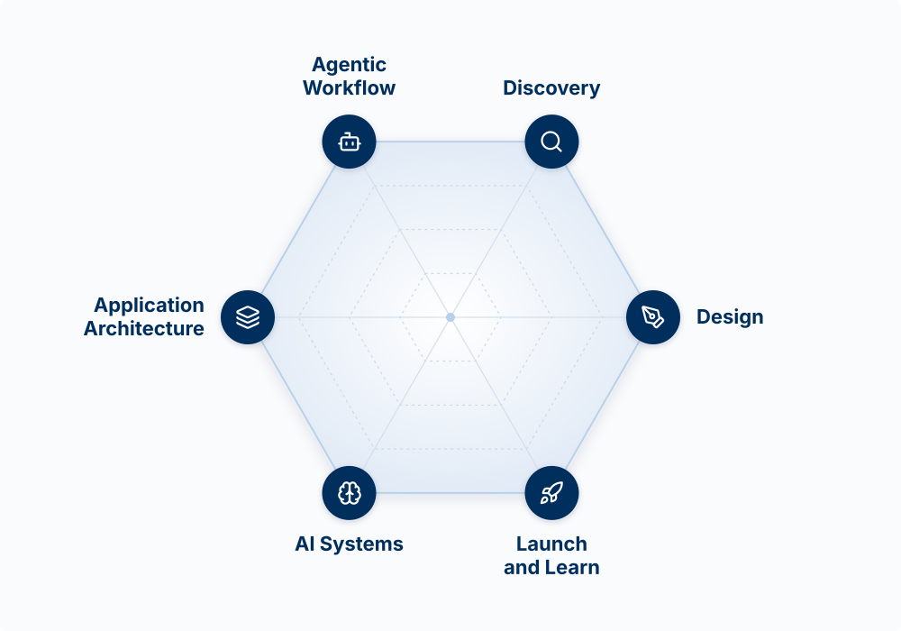

**BYU-Idaho | Winter 2027 Second Block | February 22–April 8, 2027**

| Course information | Details |
|---|---|
| **Professor** | Rob Teigen |
| **Teaching Assistant** | Kyle Matheson |
| **Professor email / GitHub username** | ________ / ________ |
| **TA email / GitHub username** | ________ / ________ |
| **Office Hours** | ________ |
| **Office Hours Location** | ________ |
| **LMS and course link** | ________ |
| **Course communication channel and link** | ________ |
| **Class Days and Time** | Two sessions weekly: Monday/Wednesday or Tuesday/Thursday, pending confirmation. Time: ________ |
| **Class Location / Delivery Format** | ________ |

## Course Numbers

| Course | Section | Title | Credit Hours |
|---|---|---|---|
| ________ | ________ | Product Management | ________ |

## Prerequisites

**Prerequisites:** ________. Students should have an interest in going deep on a technical level and learning to code with assistance from AI.

## Required Materials

A modern Laptop or desktop (Mac or Windows): - Operating Systems: macOS 10.15+ or Windows 10+ - Hardware: 4GB+ RAM (more is better)

AI Tools: **Codex is the primary option; Claude is a supported alternative.** You need access to one working coding agent, not both paid subscriptions. See [Computer Setup](00-computer-setup.qmd) for installation and current official account requirements. Account or funding arrangements for this offering: ________.

Other AI tools, including Gemini, ChatGPT, and Cursor, may supplement your selected coding agent. Optional resources and access arrangements: ________. All other materials are available online at no cost.

::: {.callout-tip title="Learning a section with your coding agent"}
Use **Learn with Codex** beside a chapter heading, or choose the **Claude** alternative. The button copies a plain-text tutoring prompt. Paste it into your chosen agent in your course repo. Both options use the same local [course workflows](00-course-workflows.qmd) and save a short log to `learning/` with your permission.
:::

## Description

This course turns product managers into full-stack AI product builders. You will pick a
problem worth solving, build a real digital product for it, put it in front of real users,
and ship it, using AI coding agents as your primary tool throughout.

The course is organized around six builder skills: **Agentic Workflow** (putting AI to work,
as the way you build and inside the product you build), **Discovery** (what to build, for
whom, and whether you should), **Design** (the surface and the flow), **Application
Architecture** (how it is structured, shipped, and kept safe), **AI Systems** (how the models
work, and why they behave the way they do), and **Launch and Learn** (how people find it, and
whether it worked). Each has a weekly emphasis in Weeks 1–6, followed by a final week of storytelling, reflection, and the showcase. You rate yourself on all six in the first week.
After that, your sprint reports show a builder profile on the same six axes, filled by your sprint
work and the two exams ([Your builder profile](00-assessments.qmd#builder-profile)).

{fig-alt="A hexagon with one builder axis at each corner, clockwise from the upper left: Agentic Workflow, Discovery, Design, Launch and Learn, AI Systems, and Application Architecture, each with an icon. Faint rings inside mark levels from the center to the edge." fig-align="center" width="70%"}

Tooling is Codex (primary) or Claude (alternative), GitHub, Next.js, Supabase, and Vercel. You do not need to arrive
knowing any of them. You will ship something in week one that you do not fully understand,
and spend the rest of the course learning what you shipped.

## Purpose

This course develops students’ ability to integrate strategic thinking and technical execution to deliver products that create genuine value for others.

## Learning Outcomes

| Learning Outcome | Learning emphasis |
|----|----|
| 1\. Explain how large language models generate text, and apply that understanding when building with them. | Intellectually Enlarging |
| 2\. Develop and articulate a product strategy grounded in customer discovery. | Intellectually Enlarging, Lifelong Learning and Service |
| 3\. Analyze the physical, mental, and spiritual impact a product is likely to have on its users, and choose accordingly. | Spiritually Strengthening, Character Building, Lifelong Learning and Service |
| 4\. Build, ship, and maintain a working digital product that delivers enduring value to a target customer group. | Intellectually Enlarging, Lifelong Learning and Service |
| 5\. Use AI coding agents to build and evaluate software, exercising judgment about when to trust, verify, or override the tool. | Intellectually Enlarging, Lifelong Learning and Service |

[]{#instructor-bio}

## Professor Bio

**Rob Teigen**

Biography: ________.

## Teaching Assistant Bio

**Kyle Matheson**

Biography: ________.

## Schedule

See the [course schedule](00-schedule.qmd) for what is taught in each of the two weekly sessions and the [assignment checklist](00-assignments.qmd) for submission dates and points. Sprint wrap-ups are due Saturdays, February 27 through April 3. Plans for Sprints 2–6 are due the preceding Saturday; Sprint 1's plan is submitted during the first class.

## Learning Model

Each week follows BYU-Idaho's three learning steps:

- **[Prepare](https://www.byui.edu/learning-model/prepare):** Prepare academically and spiritually by studying the short essentials and bringing questions to class.
- **[Teach One Another](https://www.byui.edu/learning-model/teach-one-another):** Explain ideas, demonstrate work, listen respectfully, and refine understanding through instructor-led peer activities.
- **[Ponder and Prove](https://www.byui.edu/learning-model/ponder-and-prove):** Apply concepts to your product, check the result, and reflect through the existing sprint review.

Required preparation is **20–30 minutes per week**, split between the two class sessions. Setup, building, and homework take additional time. Start with the [Week 1 essentials](W01-agentic-workflow.qmd). All full chapters remain available as optional references. The Learning Model organizes how we learn; AIRE remains the product decision framework. Classroom preparation and peer teaching add no separate graded submissions.

Exams assess the essentials and explicitly taught class material. Optional chapters do not independently add exam requirements.

## Grading

Most of your grade comes from building a real product across the course, not on exams. This is deliberate. The research this course is built on says the thing worth certifying is authentic performance, the whole game done and iterated with feedback, not recall on a test. The two exams are proctored and closed book, which makes them the one place your own understanding is measured without AI assistance, and at 5% each they are deliberately low stakes. For the reasoning behind this design, see [Why This Class Works This Way](93-why-this-class-works.qmd).

| Component | Points | % of Grade |
|-----------|--------|------------|
| Sprints 1 to 5 (5 × 50) | 250 | 55.6% |
| Sprint 6, the final build | 100 | 22.2% |
| Peer Product Testing | 50 | 11.1% |
| Midterm Exam | 25 | 5.6% |
| Final Exam | 25 | 5.6% |
| **TOTAL** | **450** | **100%** |

Every assignment and exam is described in detail in the [Assessments section](00-assessments.qmd).

The course is **not** graded on a curve. It's possible for every student to earn an A.

Achieving an A is challenging and reflects real commitment and excellence.

The grading scale is show below:

| Letter Grade | Percentage Range | GPA |
|--------------|------------------|-----|
| A            | 93–100%          | 4.0 |
| A-           | 90–92%           | 3.7 |
| B+           | 87–89%           | 3.4 |
| B            | 83–86%           | 3.0 |
| B-           | 80–82%           | 2.7 |
| C+           | 77–79%           | 2.4 |
| C            | 73–76%           | 2.0 |
| C-           | 70–72%           | 1.7 |
| D+           | 67–69%           | 1.4 |
| D            | 63–66%           | 1.0 |
| D-           | 60–62%           | 0.7 |
| E (Fail)     | Below 60%        | 0.0 |

### Late work policy

**Exams**: Both exams remain closed book and proctored. Proposed midterm window: March 12–13. Proposed final exam window: April 5–8. Windows open at 12:00 a.m. and close at 11:59 p.m. America/Boise on their listed dates. Delivery arrangements: ________. Windows cannot be extended; complete each exam within its posted window.
**Homework**: May be turned in up to 9 days late for partial credit with a 10% penalty per day according to the following schedule:

| Days Late | Late Penalty |
|-----------|--------------|
| 1         | -10%         |
| 2         | -20%         |
| 3         | -30%         |
| 4         | -40%         |
| 5         | -50%         |
| 6         | -60%         |
| 7         | -70%         |
| 8         | -80%         |
| 9         | -90%         |
| 10        | No Credit    |

**Sprint 6**: Submission deadline: Saturday, April 3, at 11:59 p.m. America/Boise. It cannot be turned in late for credit.

**Final Exam**: Complete it within the proposed April 5–8 window, closing at 11:59 p.m. America/Boise on April 8. It cannot be taken late.

## Classroom Culture

### Mission and Aims

BYU-Idaho mission and learning framework text: ________.

#### Laptop Policy

You may use laptops in class for note taking or other class related purposes. Laptops should not be used for activities that would be a distraction to nearby students when your screen is in their line of sight (e.g. sports, instagram, etc.)

#### Cold Calling

I teach in a conversational discussion based style, which includes cold calling students to ask for your input or to pose questions. If you'd rather I not cold call on you please let me know on the first day of class so that I can avoid doing so. I have deep respect for individual learning styles and will make accommodations when needed.

## Getting Help

The following resources are available to get help:

-   Start with AI chat bots and the course website to see if they can assist
-   Use the course communication channel (________) to ask classmates for help
-   Attend TA or Professor office hours
-   Contact Kyle Matheson, Teaching Assistant: ________
-   Contact Rob Teigen, Professor: ________

## Honor Code

BYU-Idaho Honor Code and academic honesty policy text: ________.

Office contact and policy link: ________.

## Preventing & Responding to Sexual Misconduct

BYU-Idaho policy text, reporting requirements, and support resources: ________.

Office contact and policy link: ________.

## Student Disability

BYU-Idaho accessibility and accommodation policy text: ________.

Office contact and policy link: ________.

## Course Sources

See [Credits and Source Attribution](99-credits.qmd) for the original course and retained author credits.
